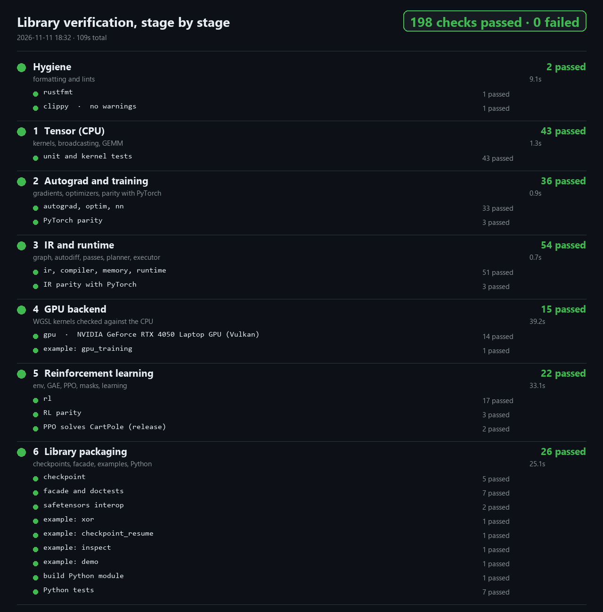
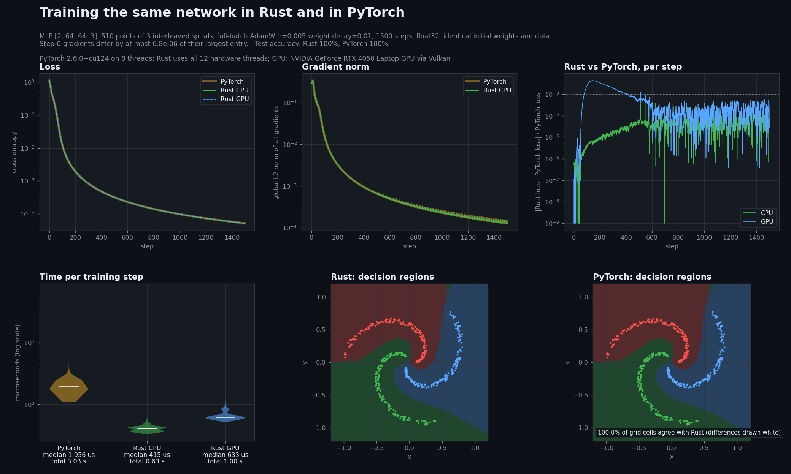
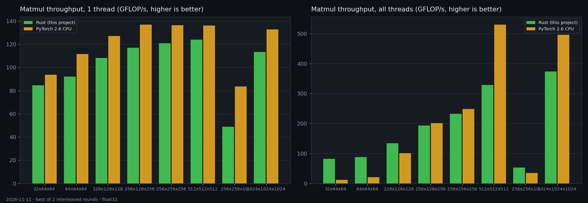
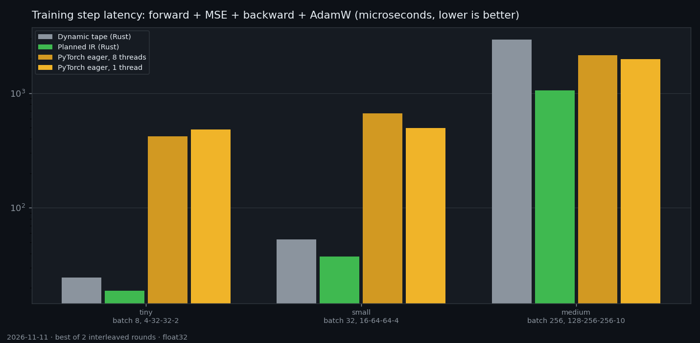
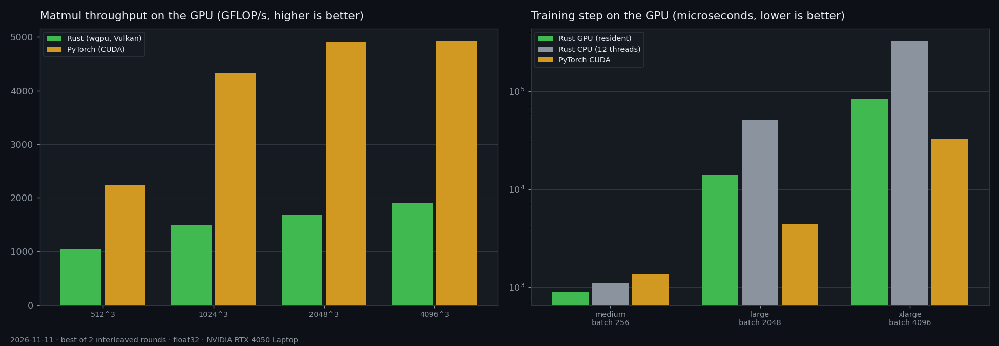
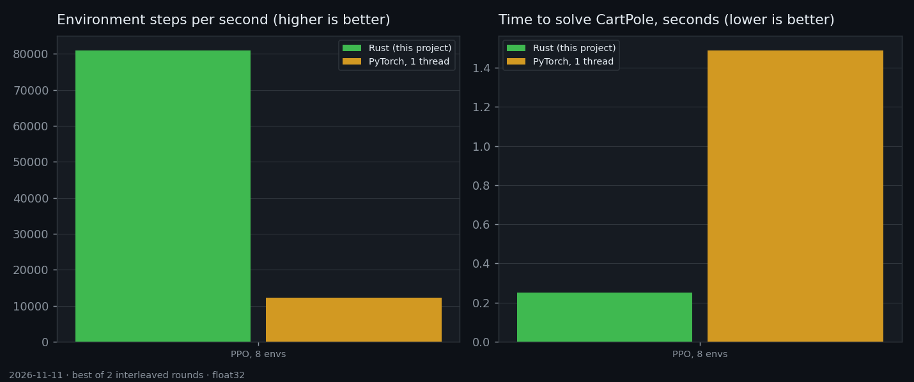

# rustai

A Rust-native AI training engine. It builds a training step as a typed graph, differentiates it,
optimises it, plans its memory once, and then runs it repeatedly out of preallocated buffers on
the CPU or the GPU. Reinforcement learning (PPO) is built on the same pipeline.

> **A student learning project**, not a production framework. It was built to understand how a deep-learning framework works inside (autodiff, graph compilation, memory planning, GPU kernels, PPO), and every claim below is backed by a test or a reproducible measurement. Tiếng Việt: [README.md](README.md).



## See it work



`python tools/demo_report.py` trains the same network ([2, 64, 64, 3], 510 points of three
interleaved spirals, 1500 full-batch AdamW steps) in Rust on the CPU, in Rust on the GPU, and in
PyTorch, all from the same initial weights and data. On the machine used for the benchmarks below:

* **Loss and gradients agree.** The loss curves differ by at most 0.07% relative, the
  gradients of step 0 by at most 7e-06 of their largest entry, and the two trained networks draw the
  same decision regions on 100% of a 100 x 100 grid.
* **Time per step:** 415 us in Rust on the CPU, 633 us on the GPU, 1,956 us for PyTorch eager
  (total 0.63 s, 1.00 s and 3.03 s). The GPU step includes downloading the
  loss and gradients every step; this network is too small for the GPU to beat the CPU.

How the pieces work (autodiff as graph nodes, the memory planner, GPU execution) is explained with
figures generated from the library itself in [docs/PRINCIPLES.md](docs/PRINCIPLES.md).

## What it does

| Stage | What is there | How it is checked |
|---|---|---|
| 1. Tensor (CPU) | f32 tensors, broadcasting, blocked GEMM with AVX2/FMA | bit-exact against an ordered reference over tile, K-block and thread boundaries |
| 2. Autograd and training | reverse-mode autodiff, SGD, AdamW, MLPs | gradients, optimizer trajectories and 30-step training runs against PyTorch |
| 3. IR and runtime | graph IR, autodiff on the IR, CSE, fusion, memory planner, allocation-free executor | optimised graphs bit-identical to unoptimised ones on random graphs; PyTorch parity |
| 4. GPU | WGSL kernels through `wgpu` (Vulkan/D3D12/Metal), on-device AdamW | every op and training step compared with the CPU executor |
| 5. Reinforcement learning | vectorised environments, GAE, PPO with action masking, shape bucketing | PPO loss and gradients against PyTorch, GAE and CartPole against NumPy, learning tests |
| 6. Library | `safetensors` checkpoints, `Trainer`, Python bindings, examples | files read by Python's `safetensors` and back; Python tests against PyTorch |

## Quick start

Supervised learning:

```rust
use rustai::prelude::*;

let mut trainer = Trainer::new(TrainerConfig {
    sizes: vec![2, 16, 2],
    batch: 4,
    loss: Loss::CrossEntropy,
    learning_rate: 0.05,
    ..TrainerConfig::default()
})?;
let x = Tensor::from_vec(vec![0., 0., 0., 1., 1., 0., 1., 1.], &[4, 2])?;
let labels = Tensor::from_vec(vec![0., 1., 1., 0.], &[4])?;
for _ in 0..300 {
    trainer.step(&x, &labels)?;
}
trainer.save(std::path::Path::new("xor.safetensors"))?; // opens directly in Python
# Ok::<(), rustai::Error>(())
```

Reinforcement learning:

```rust
use rustai::prelude::*;

let envs: Vec<Box<dyn Env>> = (0..8).map(|i| Box::new(CartPole::new(100 + i)) as Box<dyn Env>).collect();
let mut ppo = Ppo::new(envs, PpoConfig { learning_rate: 1e-3, ..PpoConfig::default() })?;
ppo.train(60_000, |_| {})?;
println!("{}", ppo.evaluate(&mut CartPole::new(7), 10)?);
# Ok::<(), rustai::Error>(())
```

Python (build with `python tools/build_python.py`):

```python
import numpy as np, rustai

trainer = rustai.MlpTrainer([4, 12, 3], batch=16, loss="cross_entropy", learning_rate=0.01)
loss = trainer.step(x, labels)          # float32 C-contiguous arrays
logits = trainer.predict(x[:5])         # any row count up to the batch size
trainer.save("model.safetensors")
```

Runnable examples: `cargo run --release -p rustai --example xor`, `cartpole_ppo`, `checkpoint_resume`.

## Results

Measured on an Intel Core i5-13420H (12 threads) and an NVIDIA GeForce RTX 4050 Laptop GPU, float32,
against PyTorch 2.6.0. Each number is the best of two interleaved rounds, because background load can
only make a run slower. One machine, one run of the benchmark suite: read the ratios as orders of
magnitude, not constants.






* **CPU matmul, one thread:** 82–91% of PyTorch (MKL) on most shapes; 58% on the narrow 256x256x10.
  With all threads it is 0.62–0.96x of PyTorch at 256–1024 and faster on small shapes.
* **CPU training step** (forward, MSE, backward, AdamW): 19 µs, 38 µs and 1.06 ms for the tiny,
  small and medium networks, against 420–480 µs, 495–670 µs and 2.0–2.1 ms for PyTorch eager.
* **GPU:** the matmul kernel reaches 34–47% of cuBLAS. A small network trains 1.5x faster than on
  PyTorch CUDA (launch overhead dominates); large networks are 2.5–3.2x slower. Against its own CPU
  backend the GPU is 3.6–3.9x faster on large networks.
* **PPO on CartPole** (same algorithm and hyperparameters, one Python thread for PyTorch):
  81,000 against 12,200 environment steps per second, and 0.25 s against 1.5 s to solve it. Learning
  curves are similar, so the gain is throughput, not sample efficiency.

## Limitations

* float32 only; an MLP-oriented layer set (no convolution, attention, LayerNorm yet).
* Shapes are fixed when a graph is built. `BucketedMlp` serves variable batch sizes for inference.
* The CPU GEMM uses AVX2/FMA but not AVX-512; the GPU GEMM is about 40% of cuBLAS.
* The Python extension is built for the interpreter that builds it (no abi3, because it uses the
  buffer protocol).
* The PyTorch baseline is eager mode on the same machine; `torch.compile` was not compared.

## Repository

See [docs/ARCHITECTURE.md](docs/ARCHITECTURE.md) for the design. Directory names have no `rt-`
prefix; package names do.

```
crates/{tensor,autograd,ir,compiler,memory,runtime,gpu,nn,optim,rl,checkpoint,rustai,python}
tests/parity     PyTorch/NumPy reference values and the tests that use them
benchmarks       Rust and PyTorch benchmarks
tools            reproduce.py, check_stages.py, demo_report.py, explain_report.py,
                 benchmark_report.py, test_report.py, build_python.py
```

## Reproducing the results

On a fresh clone, with a stable Rust toolchain and Python (tested with 3.10; `pip install -r requirements.txt`):

```bash
python tools/reproduce.py            # tests, learning tests, Python extension, demo vs PyTorch, benchmarks
python tools/reproduce.py --quick    # skips the slow learning tests, one benchmark round
```

It checks its own environment, states the pass criterion of every step, writes everything to
`target/reproduced/` (so the checkout stays clean) and exits non-zero on failure. Speed numbers are
printed, not asserted, because they depend on the machine. Details and expected output:
[docs/REPRODUCE.md](docs/REPRODUCE.md).

## Building and checking

Requires a recent stable Rust toolchain (and, on Windows, the Visual Studio C++ build tools).
Python with the packages in `requirements.txt` is needed only to regenerate fixtures, build the
bindings, run the Python tests and draw charts.

```bash
cargo test --workspace --exclude rt-python        # all Rust tests (GPU tests skip without an adapter)
cargo test --release --workspace --exclude rt-python -- --ignored   # learning tests
python tools/check_stages.py                      # every stage in turn, writes docs/images/stages.png
python tools/demo_report.py                       # Rust vs PyTorch training, writes docs/images/demo.png
python tools/explain_report.py                    # figures of docs/PRINCIPLES.md
python tools/benchmark_report.py                  # benchmarks and charts
python tests/parity/generate.py                   # regenerate the PyTorch/NumPy fixtures
cargo run --release -p rustai --features gpu --example demo -- --out target/demo --gpu
```

## License

MIT, see [LICENSE-MIT](LICENSE-MIT).
