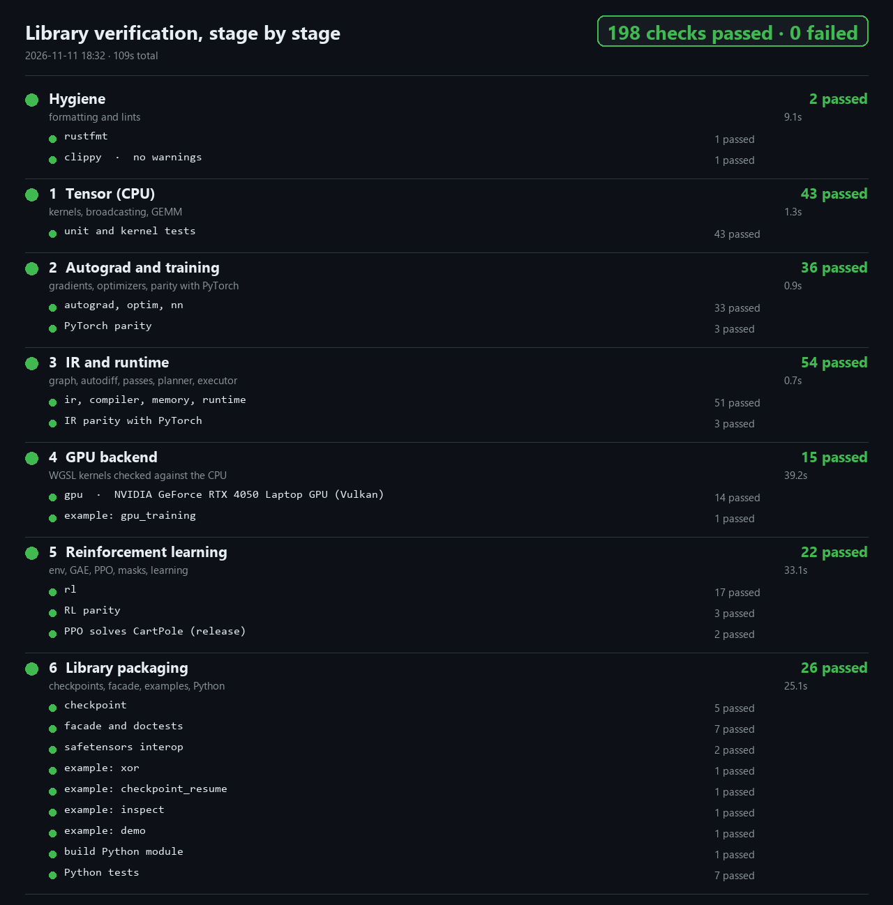
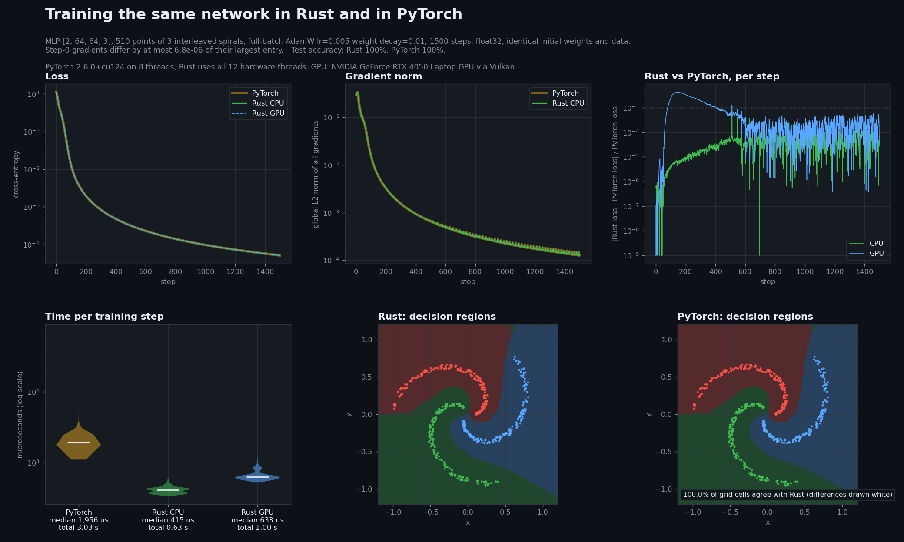
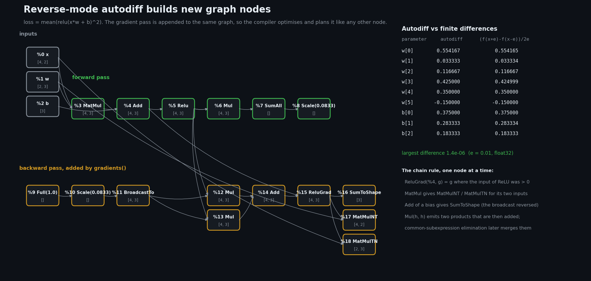
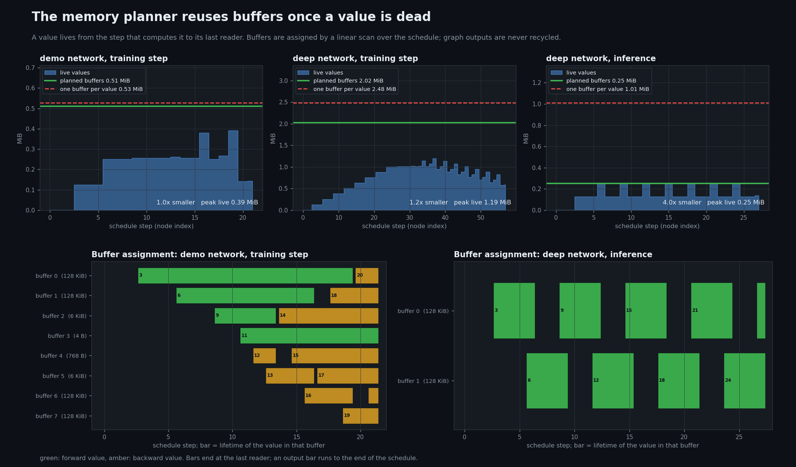
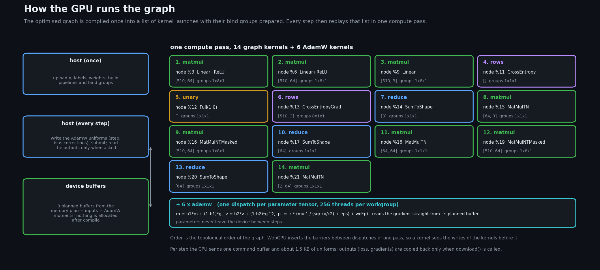
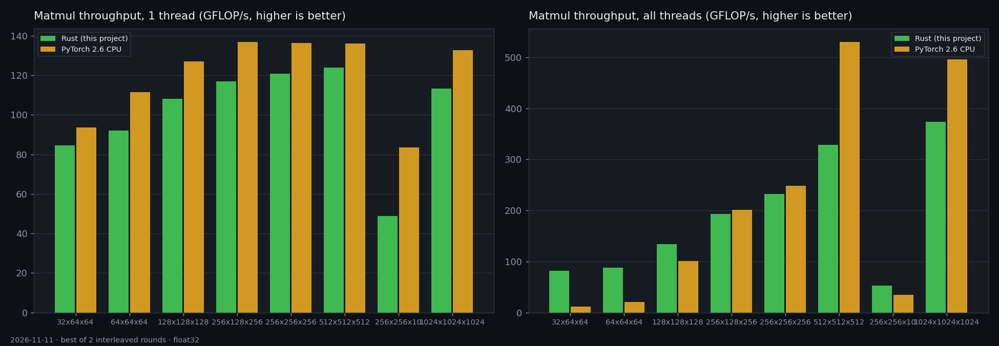
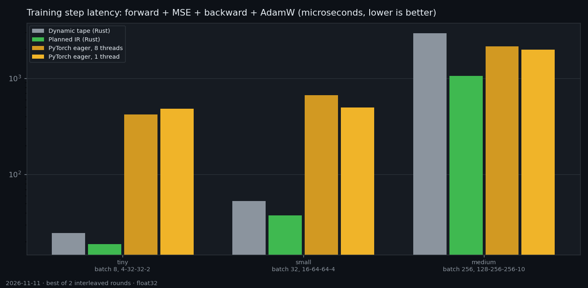
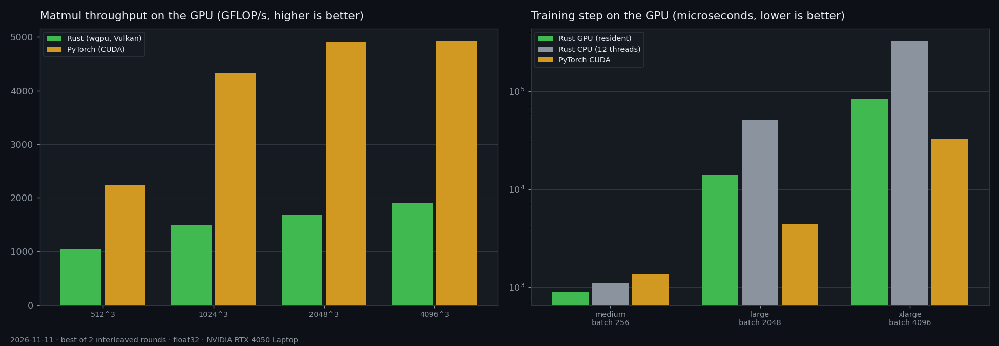
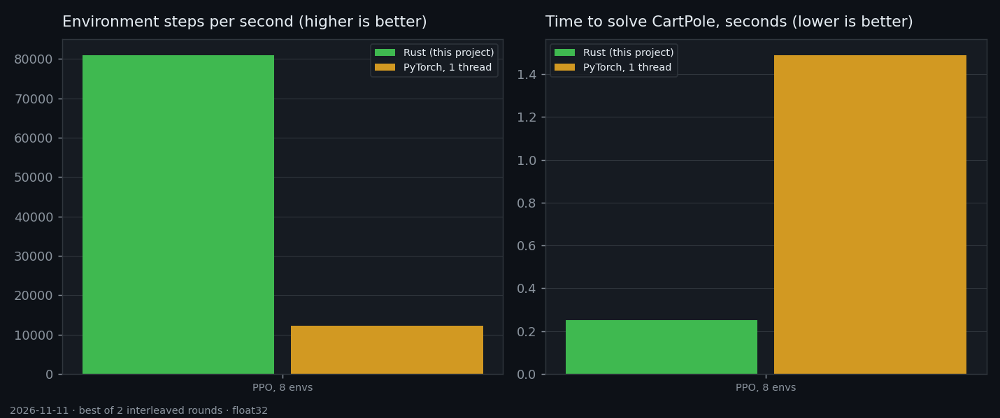

# RustAI

Dự án **tìm hiểu công nghệ của sinh viên**: tự viết từ đầu một engine huấn luyện AI bằng Rust để hiểu một framework
deep learning hoạt động bên trong như thế nào. Đây là sản phẩm học tập, **không phải** framework để dùng thật.
Mọi con số trong tài liệu này đều có test hoặc lệnh chạy lại được (xem [Chạy thử](#chạy-thử)).

English: [README.en.md](README.en.md)



## Mình đã làm gì

Một bước huấn luyện được dựng thành **đồ thị**, tự động lấy đạo hàm, tối ưu, lập kế hoạch bộ nhớ một lần rồi chạy lặp lại
trên CPU hoặc GPU mà không cấp phát thêm. Học tăng cường (PPO) chạy trên đúng pipeline đó.

| Giai đoạn | Nội dung | Kiểm chứng bằng |
|---|---|---|
| 1. Tensor (CPU) | Tensor f32, broadcasting, GEMM chia khối dùng AVX2/FMA | So từng bit với bản tính tuần tự |
| 2. Autograd và huấn luyện | Đạo hàm ngược, SGD, AdamW, MLP | Gradient, optimizer, vòng training so với PyTorch |
| 3. IR và runtime | Đồ thị, autodiff trên đồ thị, CSE, fusion, memory planner | Đồ thị đã tối ưu giống hệt từng bit đồ thị gốc |
| 4. GPU | Compute shader WGSL qua `wgpu`, AdamW chạy trên GPU | Từng op và bước training so với CPU |
| 5. Học tăng cường | Môi trường song song, GAE, PPO, action mask | Loss PPO so với PyTorch, GAE và CartPole so với NumPy |
| 6. Đóng gói | Checkpoint `safetensors`, `Trainer`, binding Python | Python đọc ghi được file; test Python so với PyTorch |

Tổng cộng 181 test Rust và 7 test Python đều đạt; thử phá code 134 lần (mutation test) thì 132 lần bị test bắt
(hai lần còn lại là thay đổi không ảnh hưởng hành vi).

## Huấn luyện cùng một mạng bằng Rust và PyTorch



Cùng mạng `[2, 64, 64, 3]`, 510 điểm của ba xoắn ốc đan nhau, 1500 bước AdamW, cùng trọng số khởi tạo
và cùng dữ liệu (`python tools/demo_report.py`):

* **Kết quả khớp PyTorch:** gradient bước đầu lệch tối đa 7e-06 so với phần tử lớn nhất; đường loss lệch tối đa
  0.07%; vùng quyết định của hai mạng trùng 100% ô lưới.
* **Thời gian mỗi bước:** 415 µs (Rust, CPU), 633 µs (Rust, GPU), 1.956 µs (PyTorch eager, CPU).
  Tổng 0.63 s so với 3.03 s. Mạng này nhỏ nên GPU không nhanh hơn CPU.

## Nguyên lý, có hình minh hoạ

Ba ý chính được giải thích trong [docs/PRINCIPLES.md](docs/PRINCIPLES.md). Các hình dưới đây do chính thư viện sinh ra:

**Autodiff sinh ra node mới của đồ thị** (khớp sai phân hữu hạn đến 1.4e-6 ở ví dụ nhỏ):



**Memory planner tái dùng buffer khi giá trị đã chết.** Với suy luận giảm 4.0× bộ nhớ trung gian; với huấn luyện chỉ giảm
1.0–1.2× vì activation phải sống đến lúc backward. Bản thân planner cũng chưa tối ưu (cao hơn mức tối thiểu 1.3–1.7×).



**GPU phát lại một danh sách kernel đã chuẩn bị sẵn** trong một compute pass:



## Benchmark so với PyTorch

Đo trên Intel Core i5-13420H (12 luồng) và NVIDIA RTX 4050 Laptop, float32, PyTorch 2.6.0 eager, lấy kết quả tốt nhất
trong hai vòng chạy xen kẽ. **Chỉ một máy, một lần đo: đọc như bậc độ lớn, không phải hằng số.**






* **Matmul CPU một luồng:** đạt 82–91% tốc độ PyTorch (MKL) ở hầu hết shape.
* **Bước training trên CPU:** 19 µs, 38 µs và 1,06 ms cho ba cỡ mạng, so với 420–480 µs, 495–670 µs và 2,0–2,1 ms của PyTorch eager.
* **GPU:** kernel matmul tự viết chỉ đạt 34–47% cuBLAS. Mạng nhỏ nhanh hơn PyTorch CUDA 1,5×, mạng lớn **chậm hơn** 2,5–3,2×.
* **PPO trên CartPole:** 81.000 so với 12.200 bước môi trường/giây, hiệu quả mẫu tương đương.

## Đọc kết quả này thế nào

Lợi thế chủ yếu đến từ **chi phí điều phối thấp** (không qua Python, không cấp phát lại), nên rõ nhất ở mô hình nhỏ và học
tăng cường. Khi tính toán chiếm phần lớn thời gian thì khoảng cách thu hẹp, và ở mạng lớn trên GPU thì kém PyTorch.
Đây là kết quả của một bài học, không phải lời khẳng định "nhanh hơn PyTorch".

## Giới hạn

* Chỉ float32 và các mạng kiểu MLP; chưa có convolution, attention, LayerNorm.
* Kích thước đồ thị cố định lúc dựng; `BucketedMlp` chỉ phục vụ suy luận với batch thay đổi.
* GEMM CPU dùng AVX2/FMA, chưa dùng AVX-512; GEMM GPU còn xa cuBLAS.
* So sánh chỉ với PyTorch eager, chưa so `torch.compile`; chỉ đo trên một máy Windows.
* Module Python gắn với phiên bản Python lúc build.
* File CI (`.github/workflows/ci.yml`) đã viết nhưng chưa từng chạy trên GitHub; chưa thử trên Linux hay macOS.

## Chạy thử

Cần Rust (bản stable) và Python để so với PyTorch (`pip install -r requirements.txt`; đã thử với Python 3.10 và PyTorch 2.6).

```bash
python tools/reproduce.py --quick    # test, demo so với PyTorch, benchmark; khoảng 6 phút lần đầu
python tools/reproduce.py            # thêm các test học (PPO giải CartPole) và vòng benchmark thứ hai
```

Từng phần riêng:

```bash
cargo test --workspace --exclude rt-python                          # test Rust (test GPU tự bỏ qua nếu không có GPU)
cargo run --release -p rustai --example xor                         # ví dụ nhỏ nhất
cargo run --release -p rustai --example cartpole_ppo                # học tăng cường
cargo run --release -p rustai --features gpu --example gpu_training # huấn luyện trên GPU
python tools/demo_report.py                                         # vẽ lại hình so với PyTorch
python tools/check_stages.py                                        # kiểm tra từng giai đoạn, vẽ lại ảnh đầu trang
```

Chi tiết, tiêu chí đạt và cách xử lý lỗi: [docs/REPRODUCE.md](docs/REPRODUCE.md).

Dùng như một thư viện:

```rust
use rustai::prelude::*;

let mut trainer = Trainer::new(TrainerConfig {
    sizes: vec![2, 16, 2],
    batch: 4,
    loss: Loss::CrossEntropy,
    learning_rate: 0.05,
    ..TrainerConfig::default()
})?;
let x = Tensor::from_vec(vec![0., 0., 0., 1., 1., 0., 1., 1.], &[4, 2])?;
let labels = Tensor::from_vec(vec![0., 1., 1., 0.], &[4])?;
for _ in 0..300 {
    trainer.step(&x, &labels)?;
}
# Ok::<(), rustai::Error>(())
```

## Cấu trúc thư mục

```
crates/            tensor, autograd, ir, compiler, memory, runtime, gpu, nn, optim, rl, checkpoint, rustai, python
tests/parity/      giá trị tham chiếu từ PyTorch/NumPy và các test dùng chúng
benchmarks/        benchmark Rust và các bản tương đương bằng PyTorch
tools/             reproduce.py, check_stages.py, demo_report.py, explain_report.py, benchmark_report.py, ...
docs/              PRINCIPLES.md, ARCHITECTURE.md, REPRODUCE.md và các ảnh trong docs/images/
research.pdf       báo cáo nghiên cứu (tiếng Việt), 12 trang
```

Tên thư mục không có tiền tố `rt-`; tên package thì có.

## Giấy phép

MIT, xem [LICENSE-MIT](LICENSE-MIT).
