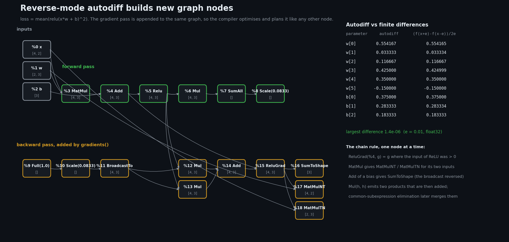
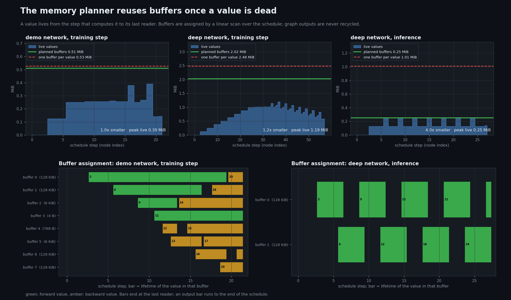
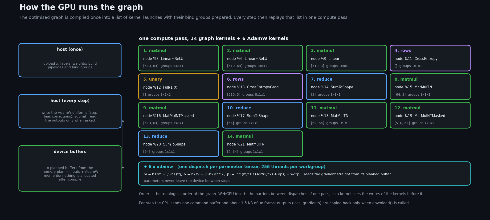
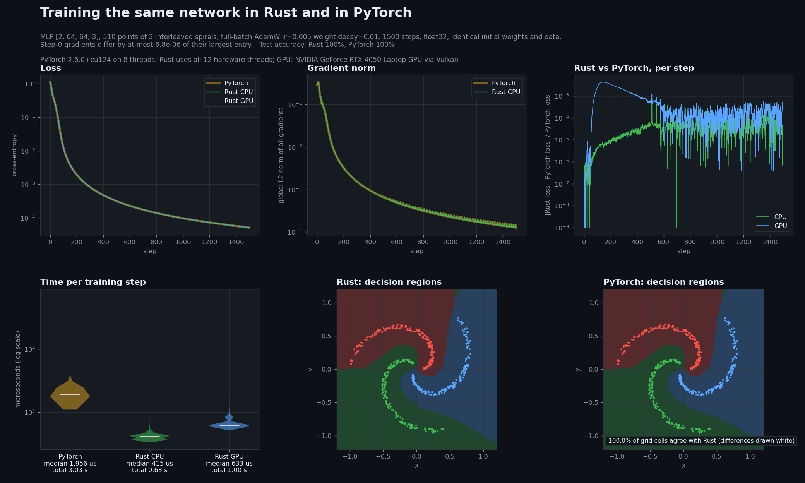

# How it works

Three ideas carry the library: **autodiff produces graph nodes**, **a planner decides where every
value lives before anything runs**, and **the GPU replays a prepared list of kernels**. This page
explains each one with numbers the library prints about itself. Every figure and table here is
generated by

```bash
python tools/explain_report.py        # runs `cargo run --example inspect`, writes docs/images/principle-*.png
```

and the raw console output is in [inspect-output.txt](inspect-output.txt).

## 1. Why autograd works

A training step computes a scalar loss `L(θ)` from the parameters `θ`. Training needs `∂L/∂θ` for
every parameter. The loss is a composition of simple operations, `L = fₙ(… f₂(f₁(θ)))`, and the
chain rule says the derivative of a composition is the product of the derivatives of its parts.

Two orders of multiplying that product are possible. *Forward mode* sweeps from the inputs and
needs one sweep per parameter. *Reverse mode* sweeps from the loss and carries one number per node
(`∂L/∂node`, the "adjoint"), so **one backward sweep yields the gradient of every parameter at about
the cost of one forward pass**. A network has millions of parameters and one loss, so reverse mode
is the only practical choice.

The sweep is simple because each operation only needs to know its *local* rule. If a node
`y = f(a, b)` receives the adjoint `ȳ = ∂L/∂y`, it passes on `ā = ȳ · ∂y/∂a` and
`b̄ = ȳ · ∂y/∂b`. A node used by several consumers receives one contribution from each, and they add.

| Forward node | Adjoints it passes back |
|---|---|
| `y = a + b` | `ā = ȳ`, `b̄ = ȳ` (summed over any broadcast dimension: `SumToShape`) |
| `y = a · b` (element-wise) | `ā = ȳ · b`, `b̄ = ȳ · a` |
| `y = a @ b` | `ā = ȳ @ bᵀ` (`MatMulNT`), `b̄ = aᵀ @ ȳ` (`MatMulTN`) |
| `y = relu(a)` | `ā = ȳ` where `a > 0`, else 0 (`ReluGrad`) |
| `y = cross_entropy(z, labels)` | `z̄ = (softmax(z) − onehot) · ȳ / rows` (`CrossEntropyGrad`) |

### How this library does it

The graph is stored in topological order, so every consumer of a node comes after it. `gradients`
in [crates/ir/src/autodiff.rs](../crates/ir/src/autodiff.rs) walks the nodes **backwards** and, for
each one that has an adjoint, **appends new nodes** that compute the adjoints of its inputs. The
backward pass is therefore not a separate mechanism. It is more of the same graph, and everything
downstream treats it like any other node: the compiler can fuse it, the planner can place it, and the
GPU can run it.



For `loss = mean(relu(x·w + b)²)` the forward pass is nodes `%3`–`%8`. Everything from `%9` on was
added by `gradients`. Reading it bottom-up shows the chain rule at work: `%10`–`%11` seed the loss
adjoint (`1/12` of each element, from the mean), `%12`–`%14` are the two products that `h · h`
generates (summed, because `h` is used twice), `%15` zeroes the entries where ReLU was inactive, and
`%16` and `%18` are the gradients of `b` and `w`. `%17` is the gradient of `x`, which nobody asked for:
`gradients` creates it eagerly and dead-code elimination removes it later.

### How we know it is right

* The table in the figure compares the graph's gradient with a central finite difference
  `(L(θ+ε) − L(θ−ε)) / 2ε`; they agree to 1.4·10⁻⁶ on this example.
* On the demo network (`[2, 64, 64, 3]`) the same check agrees to about 10⁻³ per parameter tensor
  (see `inspect-output.txt`). That residual is the *finite difference's* limit, not the
  gradient's: the loss is evaluated in float32 and divided by a small `ε`. For a sharper check the
  test suite compares against PyTorch in float64: 46 gradient cases, optimizer trajectories, 30-step
  training runs, and the PPO loss (`tests/parity`).
* Step 0 of the [demo](#4-seeing-it-run) compares every gradient of a real training step with
  PyTorch's: the largest difference is 7·10⁻⁶ of the largest gradient entry.
* Random graphs are compiled with and without the optimiser and must give identical bits.

## 2. How the memory planner saves memory

After autodiff and optimisation, the graph is a fixed list of nodes with fixed shapes. That is
enough to decide **before running anything** where every value will live.

1. **Liveness.** A value exists from the step that computes it to the step of its *last reader*
   ([liveness.rs](../crates/memory/src/liveness.rs)). Graph outputs live to the end.
2. **Linear scan.** Walk the nodes in order. For each new value take a free buffer: the tightest one
   that is large enough, otherwise the largest free one, grown to fit, otherwise a new one. When a
   value's last reader has run, its buffer becomes free again
   ([plan.rs](../crates/memory/src/plan.rs)).
3. **Validation.** `Plan::validate` re-checks, independently of the planner, that no buffer ever
   holds two live values, that every buffer is large enough, and that inputs are never given a buffer.

The executor then allocates each buffer **once**. A training step after warm-up makes no heap
allocation; `crates/nn/tests/allocation.rs` verifies it with a counting allocator.



Float32 memory of the graph's intermediate values (inputs and weights belong to the caller):

| Graph | Nodes | Buffers | One buffer per value | Planned | Peak live | Saving |
|---|---:|---:|---:|---:|---:|---:|
| demo network, training step | 22 | 8 | 0.53 MiB | 0.51 MiB | 0.39 MiB | 1.0× |
| deep network (8 × 128), training step | 58 | 20 | 2.48 MiB | 2.02 MiB | 1.19 MiB | 1.2× |
| deep network (8 × 128), inference | 28 | 2 | 1.01 MiB | 0.25 MiB | 0.25 MiB | 4.0× |

What the numbers say, without flattering them:

* **Inference reuses aggressively.** Each activation dies as soon as the next layer has read it, so
  two buffers ping-pong for the whole network (bottom right of the figure). The saving grows with
  depth.
* **Training reuses little.** The activations of the forward pass must stay alive until the backward
  pass needs them (the long green bars), and every parameter gradient is an output that can never be
  recycled. Only the short-lived temporaries of the backward pass (amber) share buffers. This is a
  property of reverse-mode training, not of this planner.
* **The plan is not optimal.** Peak live memory is a lower bound for any plan. The planner is
  1.3× above it on the demo and 1.7× on the deep network because buffers are fixed-size slots and a
  slot cannot be split. Packing values at offsets inside one arena would close most of that gap; it
  is not implemented.
* **This is not a claim to use less memory than PyTorch.** PyTorch's caching allocator also reuses
  freed blocks. What planning provides is different: no allocator calls while training, a footprint
  known at compile time, and one plan that serves both the CPU and the GPU executors.

## 3. How the GPU executes the graph

The GPU backend ([crates/gpu](../crates/gpu)) reuses the compiler and the planner unchanged, so a
graph that compiles for the CPU compiles for the GPU.



**Compile once.**

1. Optimise the graph and plan its memory, as for the CPU.
2. Create one `wgpu` storage buffer per planned buffer and one per input.
3. Pick a WGSL kernel for every node (`kernels.rs`): `matmul` for `MatMul`, `MatMulNT`,
   `MatMulTN` and the fused `Linear` / `MatMulNTMasked` (bias, ReLU and mask are applied in the
   kernel's epilogue); `reduce` for `SumToShape`; `rows` for cross-entropy and log-softmax; `unary`
   and `binary` for element-wise work. Each kernel's shape, strides and constants go into a small
   uniform buffer.
4. Build a **bind group** per node (its input and output buffers) and record the dispatch size. The
   result is a list of `(pipeline, bind group, workgroup count)` triples.

**Every step.** `execute()` writes the few uniforms that change (AdamW's step count), opens one
compute pass, replays the list in topological order, and submits it. WebGPU tracks hazards between
dispatches inside a pass, so a kernel sees the writes of the ones before it. The optimiser kernels
come last: one AdamW dispatch per parameter tensor reads the gradient straight out of its planned
buffer and updates the parameter and its two moment buffers in place.

**What crosses the PCIe bus.** Inputs and weights are uploaded once. Per step the CPU sends one
command buffer and about 1.5 KB of uniforms. Reading results back is optional: `download()` copies
every graph output (the loss and all gradients, 18 KB for the demo network), and the parameters stay
on the device until `read_input` fetches them. The demo logs the loss every step, so its GPU step
time includes that download; a loop that downloads every 100 steps, like `examples/gpu_training.rs`,
is faster.

For the demo network the schedule is 14 graph kernels (8 `matmul`, 3 `reduce`, 2 `rows`, 1 `unary`)
plus 6 AdamW kernels. Each GPU kernel is compared with the CPU executor on random inputs in
`crates/gpu/tests`, and whole training steps agree with the CPU to float32 tolerance.

The GPU's strength is launch cost amortised over many small kernels in one pass; its weakness is the
matrix-multiply kernel, which reaches 34–47% of cuBLAS (see the README for benchmarks). The `unary`
kernel in the schedule above is `Full(1.0)`: a constant the gradient seed needs, which the compiler
does not yet fold away.

## 4. Seeing it run

`python tools/demo_report.py` trains one network in Rust (CPU and GPU) and in PyTorch from identical
weights and data and draws the result:



* Both frameworks start from the same `initial.safetensors` and see the same 510 points.
* The loss and gradient-norm curves lie on top of each other; the third panel shows how far they
  drift apart (the CPU's largest relative difference is 7.5·10⁻⁴, usually about 10⁻⁴; the GPU peaks near
  4·10⁻³ early on, where the loss is small and its summation order differs).
* Step time is measured around the whole step (forward, backward, AdamW, reading the loss).
* The decision regions of the two trained networks agree on every cell of the 100 × 100 grid.

Numbers from the last run are in [demo-summary.json](demo-summary.json). They are single-machine,
single-run figures; `REPRODUCE.md` explains how to regenerate them.
